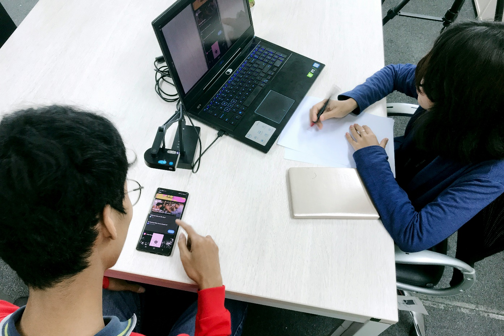
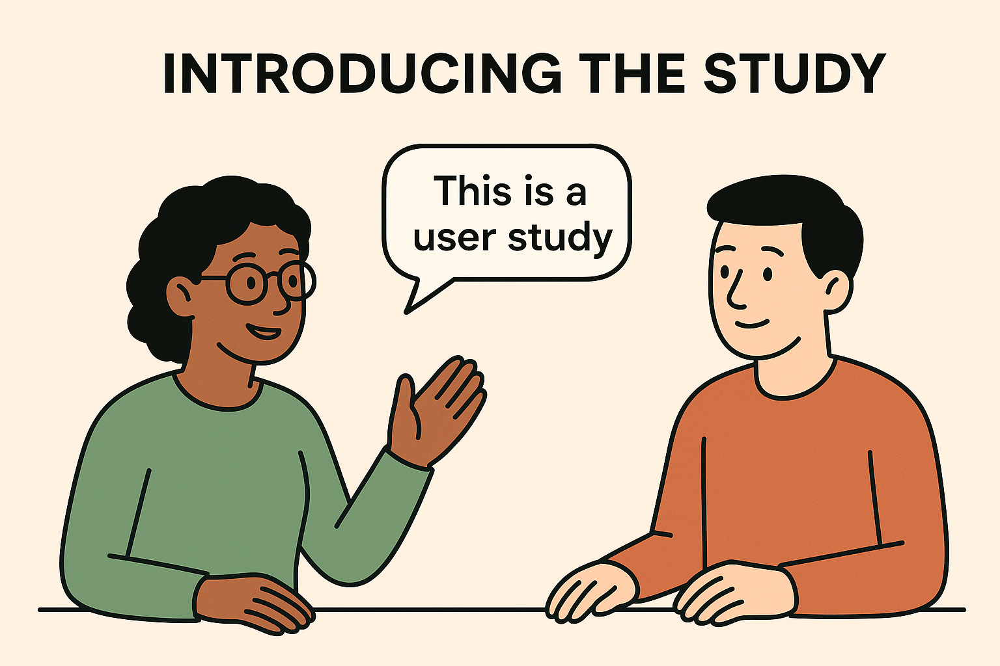
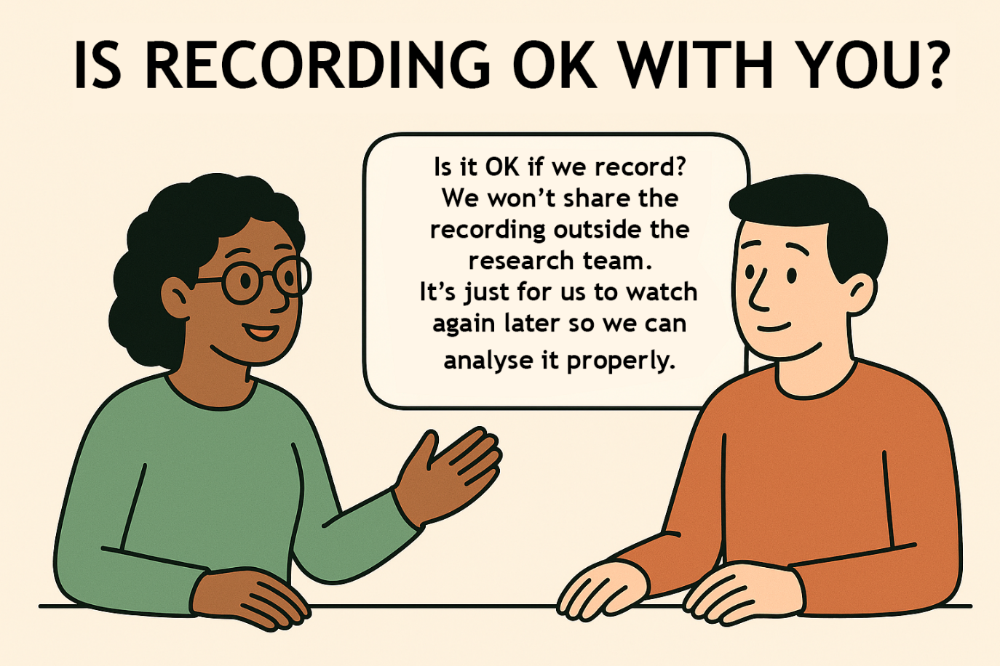
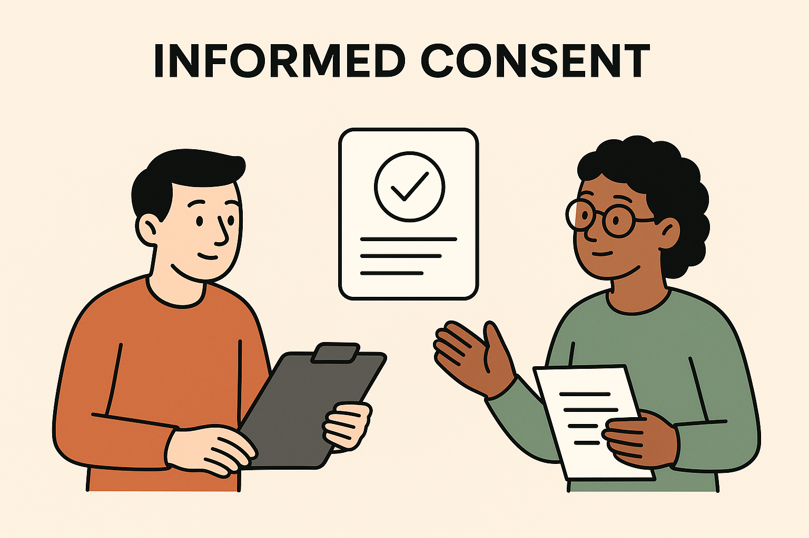
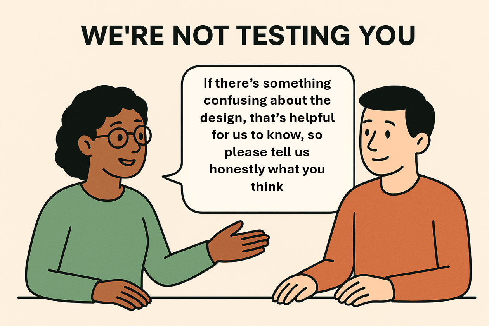
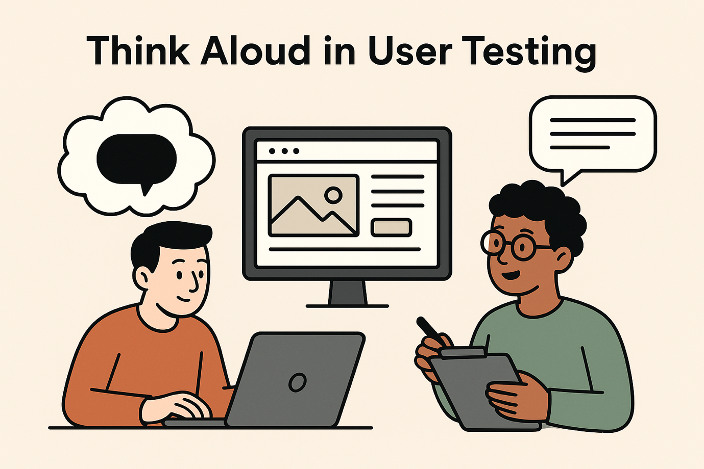

# User Experience (UX) Testing Guide

**Usability testing** starts by welcoming participants and explaining the purpose: improving the design, not testing them.  

Confirm consent, confidentiality, and that participation is voluntary. Be clear about recording and observers and let participants know they can stop anytime. Reassure them with ***“We are not testing you; we are testing the application.”***  

Give tasks one at a time using realistic scenarios without hints. Ask participants to think aloud so you understand their thought process and use neutral prompts if they go quiet.  

End by thanking them, asking for overall impressions, and reminding them how their data will be used.

Welcome the Participant Introduce yourself and set a friendly, relaxed tone.

Use “study” or “research” rather than “test” to avoid intimidating participants

**Welcome & Intro**

  - Set a **friendly tone** and make participants feel comfortable.

  - Explain **what will happen** and **why**.

  - Reinforce **voluntary participation** and **confidentiality**.

  - Prepare them for **think-aloud** and **task-based testing**.

**Key Points to Cover**

1.  **Greeting & Thank You** *“Thank you for joining us today. We really appreciate your time.”*

2.  **Purpose of the Study** *“We’re testing the design of \[product/prototype\] to see how well it supports real tasks. We’re not testing you, there are no right or wrong answers.”*

3.  **Session Overview** *“You’ll complete a few tasks based on real-world scenarios. We’ll ask you to think aloud as you go so, we understand your thought process.”*

4.  **Observers & *Recording*** *“This session will be recorded for research purposes only, and there are observers watching remotely. They won’t interact with you.”*

5.  **Confidentiality & Consent** *“Your responses will remain confidential. You can stop at any time or skip any question.”*

6.  **Encourage Honest Feedback** *“If something is confusing or frustrating, please tell us. That’s exactly what we need to know.”*

7.  **Questions Before Starting** *“Do you have any questions before we begin?”*

**Inform about Observers and Recording. Be transparent about any observers and whether you'll record. Confirm with them again at the start of the session.**

*“Before we start, I want to let you know that this session will be recorded so we can review it later and improve the design. The recording will only be used internally and will not be shared outside the team. There are a few observers watching remotely. they’re here to learn from your experience, not to evaluate you. If you have any concerns or want to stop at any time, just let me know.”*

**Why It Matters**

  - **Transparency builds trust**: Participants need to know who is observing and what is being recorded.

  - **Ethical compliance**: Many organisations follow GDPR or similar privacy regulations, so explicit consent is required.

  - **Comfort and openness**: If participants feel blindsided by observers or recording, they may act unnaturally.

**Before the Session (Consent Form)**

Clearly state:

  - Whether the session will be recorded (audio, video, screen).

  - Who will have access to the recordings.

  - Purpose of the recording (e.g., design improvement, internal review).

  - Get written or digital consent.

**Example Intro Script:**

> *“Hi, thanks for coming today. We’re doing this session to learn how people use \[product/prototype\] so we can improve it. We’re not testing you, there are no right or wrong answers. We’ll ask you to complete some tasks and think aloud as you go. The session will be recorded for research purposes only, and there are observers watching remotely. Everything you share will be kept confidential, and you can stop at any time. If anything is unclear or frustrating, please let us know. Do you have any questions before we start?”*

**At the Start of the Session**

Reconfirm verbally:

  - ***“Just to remind you, this session will be recorded for research purposes.”***

  - ***“There are observers watching remotely/in the room. They will not interact with you.”***

Give the participant a chance to ask questions or opt out.

**Explain Observer Role**

  - ***“Observers are here to learn from your experience, not to judge you.”***

  - ***“They will remain silent so you can focus on the tasks.”***

**Offer Control**

  - “If you feel uncomfortable at any point, you can pause or stop the recording.”

  - “You can also choose to skip any question or task.”

Ask the Participant to Sign Consent. Get formal consent. If remote, send a link; if in person, use a paper form) Make sure participants understand what they are consenting to (e.g., recording)

Informed consent means participants **fully understand what the study involves** and **agree voluntarily** before taking part. It’s an ethical and often legal requirement (e.g., GDPR in the UK/EU).  

**Key Elements of Informed Consent**

1.  **Purpose of the Study** Explain why the test is being conducted (e.g., improving usability, not evaluating the user).

2.  **What Will Happen** Describe the activities: tasks, scenarios, think-aloud, recording, observers.

3.  **Data Handling** What data will be collected (video, audio, screen, notes) and how it will be stored, who will access it, and for how long.

4.  **Voluntary Participation** Emphasise that participation is optional and they can withdraw at any time without penalty.

5.  **Risks and Benefits** Usually minimal risk, but state any potential discomfort (e.g., being recorded).

6.  **Confidentiality** Explain how anonymity will be maintained (e.g., names removed from reports).

7.  **Contact Information** Provide a way to ask questions or raise concerns.

Provide a **written consent form** before the session.

Use **plain language** (avoid legal jargon).

Reconfirm verbally at the start of the session.

Allow time for questions.

**“We are not testing you; we are testing the application”** is a key principle in usability testing and user experience research

**1. Reduce Participant Anxiety**

  - Many participants feel like they’re being evaluated, which can cause stress or self-consciousness.

  - If they think their performance is being judged, they might try to “do well” instead of behaving naturally.

  - This reassurance helps them relax and interact with the product as they normally would.

**2. Encourage Honest Feedback**

  - When users feel they’re being tested, they may avoid admitting confusion or mistakes.

  - By clarifying that the product is under evaluation, participants are more likely to share genuine frustrations and difficulties.

**3. Maintain Neutrality**

  - Usability testing is about observing how the design supports tasks, not how skilled the user is.

  - The facilitator wants to make clear that any problems encountered are likely due to the interface, not the user’s ability.

**4. Improve Data Quality**

  - Stress and fear of judgment can skew results.

  - A relaxed participant provides more authentic insights, which leads to better design decisions.

**Give tasks and scenarios one by one and encouraging “think aloud”** during usability testing:

**Give Tasks One by One**

  - **Keeps focus**: Users concentrate on the current task without being influenced by future tasks.

  - **Avoids bias**: If they know all tasks upfront, they might change behaviour or anticipate features.

  - **Improves data quality**: You capture natural reactions for each scenario.

**How to Present Tasks**

  - **Use realistic scenarios**: Frame tasks as real-world goals, not instructions like “click here.”

> Example: ***“Imagine you want to book a train ticket for tomorrow. Show me how you’d do that.”***

**Give context, not hints**: Avoid telling them which feature to use.

**One at a time**: After completing a task, introduce the next scenario.

**Think-Aloud Protocol**

**Purpose**: Helps you understand the user’s thought process, not just their actions.

**How to encourage it**:

Start with: ***“As you go through the tasks, please say out loud what you’re thinking—what you expect to happen, what you’re looking for, and any confusion.”***

During tasks: ***“Keep talking as you go, what’s going through your mind?”***

**If they go quiet**: ***“What are you thinking right now?”*** and **“*What made you choose that option?”***

**Facilitator Tips**

Don’t lead or correct them.

Use neutral prompts like: ***“Tell me what you’re looking for.”*** ***and “What do you expect to happen next?”***

Avoid phrases that sound like judgment (e.g., ***“Why did you do that?”***).

**Facilitator Quick Prompts**

**Welcome & Intro**

  - Thank you for joining us today.

  - We’re testing the design, not you, there are no right or wrong answers.

  - You’ll complete a few tasks and think aloud as you go.

  - Do you have any questions before we start?

**Observer & Recording Transparency**

  - This session will be recorded for research purposes only.

  - Observers may be watching remotely; they won’t interact with you.

  - You can stop the recording or withdraw at any time.

**Think-Aloud Prompts**

  - Please say out loud what you’re thinking, what you expect and what you’re looking for.

  - What are you thinking right now?

  - What made you choose that option?

  - Keep talking as you go, what’s going through your mind?

**Task Delivery**

  - Imagine you need to pay your electricity bill online. Show me how you’d do that.

  - We’ll give you one scenario at a time.

  - If something feels confusing or frustrating, please tell us.

**Wrap-Up**

  - Thank you for your time today.

  - Do you have any overall impressions or feedback?

  - Your responses will remain confidential.

  - Here’s our contact info if you have questions later.
